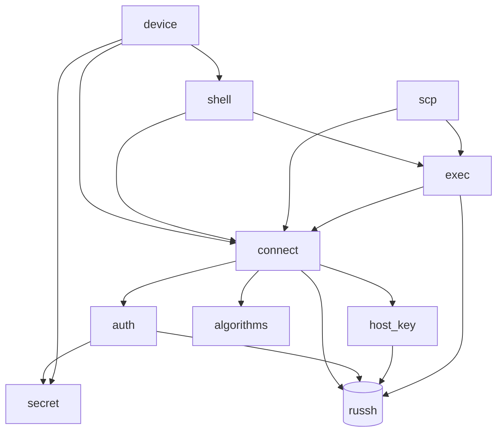
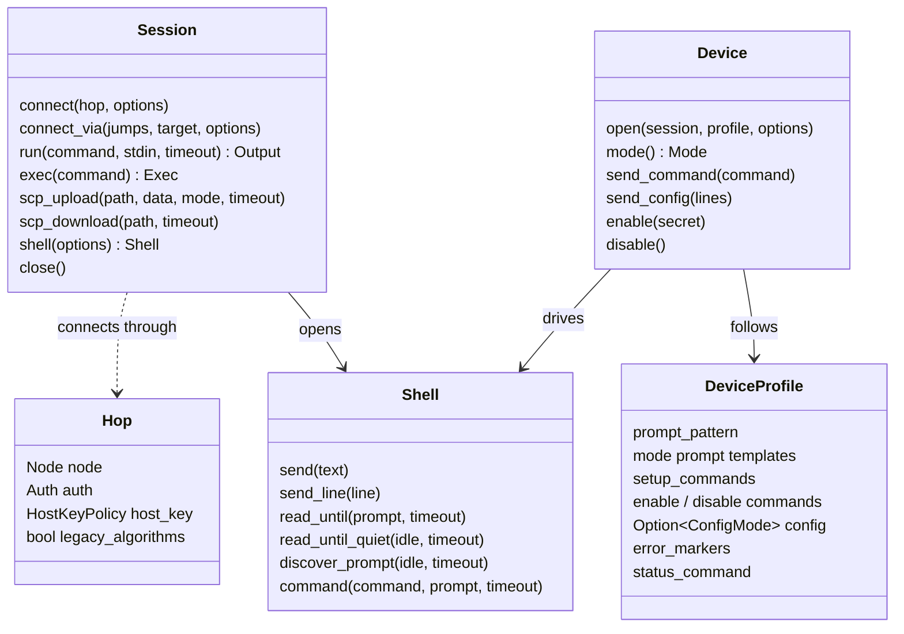

# Architecture

How Jato is built: its layers, its modules and how they depend on each other, and one
document per part. Keep these documents current: when you change how a part works, update
its document here, or add one and list it below.

## Documents

| Document | Covers |
| -------- | ------ |
| [connecting.md](connecting.md) | Connections, jump hosts, host key checking, algorithms, authentication |
| [exec.md](exec.md) | Running commands over an exec channel |
| [scp.md](scp.md) | Copying files with SCP |
| [shell.md](shell.md) | Interactive shells on a PTY, prompt matching and discovery |
| [device.md](device.md) | Device CLIs: profiles, modes, enable, configuration |
| [errors.md](errors.md) | The error type and what errors may and may not contain |
| [secrets.md](secrets.md) | How passwords, keys and passphrases are held |
| [testing.md](testing.md) | Unit tests, the test container, and tests against real devices |

## Layers

Jato is a library in four layers. Each uses only the ones below it, and callers can use any
of them: run a command on a Linux host with `Session::run`, or drive a router's CLI with
`Device`.

```text
 ┌──────────────────────────────────────────────────────────────────────┐
 │ Caller                                                               │
 └──────┬───────────────────────────┬──────────────────────┬────────────┘
        │                           │                      │
 ┌──────▼───────────────────┐       │                      │
 │ Device CLIs  (device/)   │       │                      │
 │ profiles, modes, enable, │       │                      │
 │ config, commit, errors   │       │                      │
 └──────┬───────────────────┘       │                      │
 ┌──────▼───────────────────┐ ┌─────▼──────────────┐ ┌─────▼─────────────┐
 │ Interactive shell        │ │ Commands           │ │ File copies       │
 │ (shell.rs) PTY, prompts, │ │ (exec.rs) stdin,   │ │ (scp.rs) through  │
 │ discovery, echo sync     │ │ stdout, stderr,    │ │ the remote `scp`  │
 │                          │ │ exit status        │ │                   │
 └──────┬───────────────────┘ └─────┬──────────────┘ └─────┬─────────────┘
 ┌──────▼──────────────────────────▼──────────────────────▼─────────────┐
 │ Session  (connect.rs)                                                │
 │ hops and jump chains, time limits, one russh connection per hop      │
 │   uses: auth.rs (credentials, attempt order)                         │
 │         host_key.rs (known_hosts, policies)                          │
 │         algorithms.rs (modern by default, legacy by opt-in)          │
 └──────┬───────────────────────────────────────────────────────────────┘
 ┌──────▼───────────────────────────────────────────────────────────────┐
 │ russh (SSH protocol)        tokio (async I/O, timers)                │
 └──────────────────────────────────────────────────────────────────────┘

 Across all layers: error.rs (one Error type), secret.rs (Secret), node.rs (Node)
```

## Modules

Every module is private; `lib.rs` re-exports the public types, so the module layout can
change without changing the API.

| Module | Public types | Purpose |
| ------ | ------------ | ------- |
| `node` | `Node` | A server's host and port, used in settings and errors |
| `secret` | `Secret` | A password, key or passphrase, wiped on drop, redacted in `Debug` |
| `error` | `Error` | The one error type, grown per module, `#[non_exhaustive]` |
| `auth` | `Auth` | Credentials, the order they are tried, and logging in through `russh` |
| `host_key` | `HostKeyPolicy` | `known_hosts` matching, the policies, recording new keys |
| `algorithms` | (none) | The algorithm lists offered in the handshake, with legacy ones by opt-in |
| `connect` | `Session`, `Hop`, `ConnectOptions` | Direct connections and jump chains |
| `exec` | `Exec`, `Event`, `Exit`, `Output` | Commands over an exec channel |
| `scp` | (methods on `Session`) | Single-file copies through the remote `scp` program |
| `shell` | `Shell`, `ShellOptions`, `Prompt` | PTY shells, prompt matching, discovery, output cleaning |
| `device` | `Device`, `DeviceOptions`, `DeviceProfile`, `ConfigMode`, `Mode` | Device CLIs driven through a shell |

The `device` module is split into `cli.rs` (`Device`), `profile.rs` (`DeviceProfile`,
`ConfigMode`, `Mode`, and turning a discovered prompt into mode prompts) and `profiles.rs`
(the built-in profiles).

How the modules depend on each other (an arrow means "uses"):



`error` and `node` are used by every module and are left out of the graph. `shell` uses
`exec` for the channel event plumbing (turning `russh` channel messages into stdout,
stderr and exit events, and waiting for the server to accept a request), not for running
commands.

## Main types



## Design rules

These come from `AGENTS.md` and shape every part:

- **Secure by default.** Host keys are checked unless the caller chooses `Insecure` by name;
  legacy algorithms are offered only to hops that opt in.
- **No secrets in logs, spans or errors.** Commands and configuration lines are never logged
  or put in errors, as they may hold a secret; errors name what was being done instead.
- **Every network operation has a time limit.** Connecting and logging in have their own; each
  command, copy and prompt read takes one.
- **Typed errors.** One `thiserror` enum, never `anyhow`, never `unwrap` or `expect` outside
  tests.
- **Nothing assumed about devices.** Prompts are discovered on the device, not built from its
  hostname.
