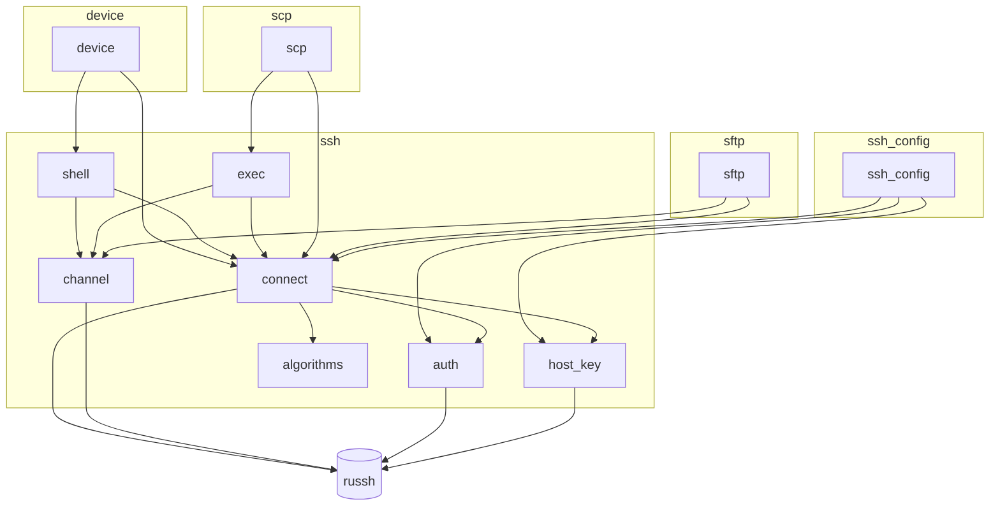
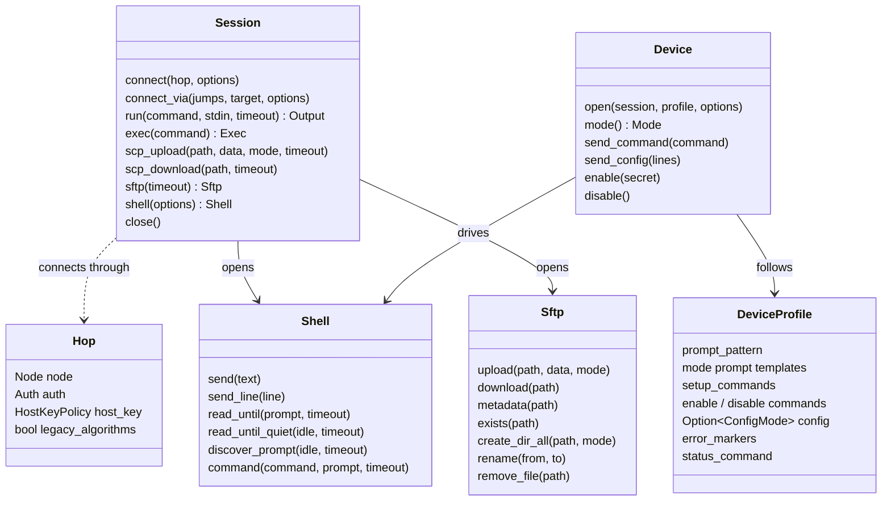

# Architecture

How Jato is built: its layers, its modules and how they depend on each other, and one
document per part. Keep these documents current: when you change how a part works, update
its document here, or add one and list it below.

## Documents

| Document | Covers |
| -------- | ------ |
| [connecting.md](connecting.md) | Connections, jump hosts, host key checking, algorithms, authentication |
| [exec.md](exec.md) | Running commands over an exec channel |
| [scp.md](scp.md) | Copying files with SCP |
| [sftp.md](sftp.md) | File transfer with Jato's own SFTP client, and safe uploads |
| [ssh_config.md](ssh_config.md) | Reading OpenSSH client configuration into hops and routes |
| [shell.md](shell.md) | Interactive shells on a PTY, prompt matching and discovery |
| [device.md](device.md) | Device CLIs: profiles, modes, enable, configuration |
| [errors.md](errors.md) | The error type and what errors may and may not contain |
| [secrets.md](secrets.md) | How passwords, keys and passphrases are held |
| [testing.md](testing.md) | Unit tests, the test container, and tests against real devices |

## Layers

Jato is a library in four layers. Each uses only the ones below it, and callers can use any
of them: run a command on a Linux host with `Session::run`, or drive a router's CLI with
`Device`.

```text
 ┌──────────────────────────────────────────────────────────────────────┐
 │ Caller           (optionally: ssh_config/ turns ~/.ssh/config into   │
 │                   hops and routes for Session)                       │
 └──────┬───────────────────────────┬──────────────────────┬────────────┘
        │                           │                      │
 ┌──────▼───────────────────┐       │                      │
 │ Device CLIs  (device/)   │       │                      │
 │ profiles, modes, enable, │       │                      │
 │ config, commit, errors   │       │                      │
 └──────┬───────────────────┘       │                      │
 ┌──────▼───────────────────┐ ┌─────▼──────────────┐ ┌─────▼─────────────┐
 │ Interactive shell        │ │ Commands           │ │ File copies       │
 │ (ssh/shell.rs) PTY,      │ │ (ssh/exec.rs)      │ │ (sftp/) own SFTP  │
 │ prompts, discovery, echo │ │ stdin, stdout,     │ │ client; (scp/)    │
 │ sync                     │ │ stderr, exit       │ │ via remote `scp`  │
 └──────┬───────────────────┘ └─────┬──────────────┘ └─────┬─────────────┘
 ┌──────▼──────────────────────────▼──────────────────────▼─────────────┐
 │ Session  (ssh/connect.rs)                                            │
 │ hops and jump chains, time limits, one russh connection per hop      │
 │   uses: ssh/auth.rs (credentials, attempt order)                     │
 │         ssh/host_key.rs (known_hosts, policies)                      │
 │         ssh/algorithms.rs (modern by default, legacy by opt-in)      │
 └──────┬───────────────────────────────────────────────────────────────┘
 ┌──────▼───────────────────────────────────────────────────────────────┐
 │ russh (SSH protocol)        tokio (async I/O, timers)                │
 └──────────────────────────────────────────────────────────────────────┘

 Across all layers, in shared/: error.rs (Error), secret.rs (Secret), node.rs (Node),
 time.rs (time limits)
```

## Modules

The source is grouped by area. Every module is private; `lib.rs` re-exports the public types,
so the layout can change without changing the API. `mod.rs` files hold only declarations.

```text
src/
  lib.rs              re-exports the public API
  shared/             used across the library
    error.rs          Error
    glob.rs           host patterns: *, ?, ! negation
    node.rs           Node
    secret.rs         Secret
    time.rs           within(): the time limit helper
  ssh/                the SSH connection and its channels
    connect.rs        Session, Hop, ConnectOptions; jump chains
    auth.rs           Auth; attempt order; logging in
    host_key.rs       HostKeyPolicy; known_hosts
    algorithms.rs     algorithm lists, legacy by opt-in
    channel.rs        channel messages to stdout/stderr/exit events
    exec.rs           Exec, Event, Exit, Output; commands
    shell.rs          Shell, ShellOptions, Prompt; PTY shells
  scp/                SCP copies (methods on Session)
    protocol.rs       headers, replies, quoting, path checks
    copy.rs           upload and download
  sftp/               Jato's own SFTP version 3 client
    packet.rs         requests and replies, encoded and decoded
    attrs.rs          Metadata
    client.rs         Sftp: uploads, downloads, directories, renames
  ssh_config/         OpenSSH client configuration
    lexer.rs          a line into keyword and values
    file.rs           files and Include into directives
    resolve.rs        HostConfig under OpenSSH's rules; ProxyJump
    hop.rs            HostConfig into Node, Auth, HostKeyPolicy, Hop
    config.rs         SshConfig, Route
  device/             device CLIs over a shell
    cli.rs            Device, DeviceOptions
    profile.rs        DeviceProfile, ConfigMode, Mode; prompts from a discovered prompt
    profiles.rs       the built-in profiles
```

| Module | Public types | Purpose |
| ------ | ------------ | ------- |
| `shared::node` | `Node` | A server's host and port, used in settings and errors |
| `shared::secret` | `Secret` | A password, key or passphrase, wiped on drop, redacted in `Debug` |
| `shared::error` | `Error` | The one error type, grown per module, `#[non_exhaustive]` |
| `shared::time` | (none) | Running an operation within a time limit, as `Error::Timeout` |
| `shared::glob` | (none) | Host patterns with `*`, `?` and `!`, for `known_hosts` and `ssh_config` |
| `ssh::auth` | `Auth` | Credentials, the order they are tried, and logging in through `russh` |
| `ssh::host_key` | `HostKeyPolicy` | `known_hosts` matching, the policies, recording new keys |
| `ssh::algorithms` | (none) | The algorithm lists offered in the handshake, with legacy ones by opt-in |
| `ssh::connect` | `Session`, `Hop`, `ConnectOptions` | Direct connections and jump chains |
| `ssh::channel` | (none) | Channel messages as events; waiting for a request's reply |
| `ssh::exec` | `Exec`, `Event`, `Exit`, `Output` | Commands over an exec channel |
| `ssh::shell` | `Shell`, `ShellOptions`, `Prompt` | PTY shells, prompt matching, discovery, output cleaning |
| `scp` | (methods on `Session`) | Single-file copies through the remote `scp` program |
| `sftp` | `Sftp`, `Metadata` | File transfer over the `sftp` subsystem; uploads through a temporary file and a rename |
| `ssh_config` | `SshConfig`, `Route`, `HostConfig`, `JumpHost`, `StrictHostKeyChecking` | OpenSSH client configuration into hops and routes |
| `device` | `Device`, `DeviceOptions`, `DeviceProfile`, `ConfigMode`, `Mode` | Device CLIs driven through a shell |

How the modules depend on each other (an arrow means "uses"):



`shared` (error, glob, node, secret, time) is used by every module and is left out of the graph.
`channel` holds what `exec` and `shell` share: turning `russh` channel messages into stdout,
stderr and exit events, and waiting for the server to accept a request.

## Main types



## Design rules

These come from `AGENTS.md` and shape every part:

- **Secure by default.** Host keys are checked unless the caller chooses `Insecure` by name;
  legacy algorithms are offered only to hops that opt in.
- **No secrets in logs, spans or errors.** Commands and configuration lines are never logged
  or put in errors, as they may hold a secret; errors name what was being done instead.
- **Every network operation has a time limit.** Connecting and logging in have their own; each
  command, copy and prompt read takes one.
- **Typed errors.** One `thiserror` enum, never `anyhow`, never `unwrap` or `expect` outside
  tests.
- **Nothing assumed about devices.** Prompts are discovered on the device, not built from its
  hostname.
