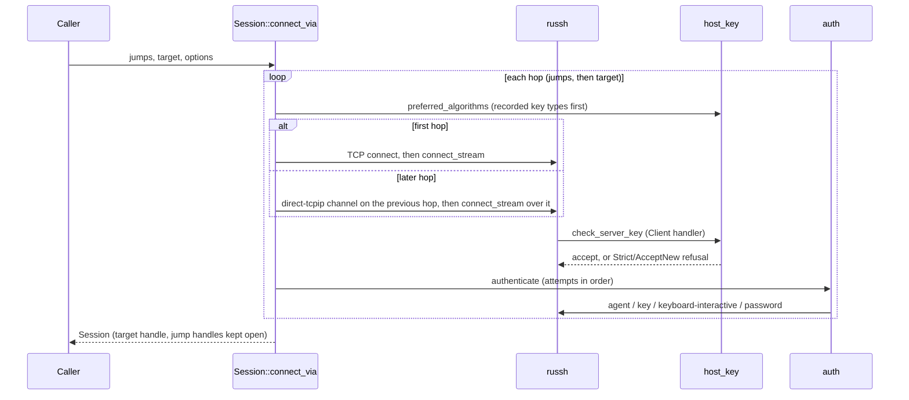
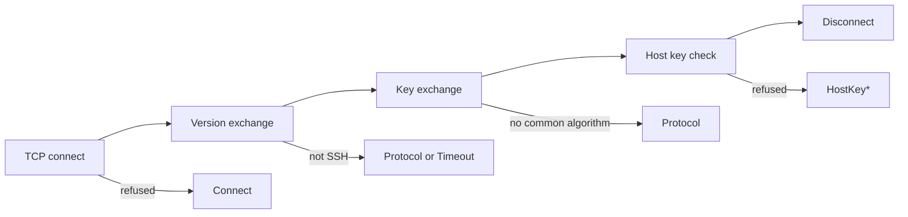
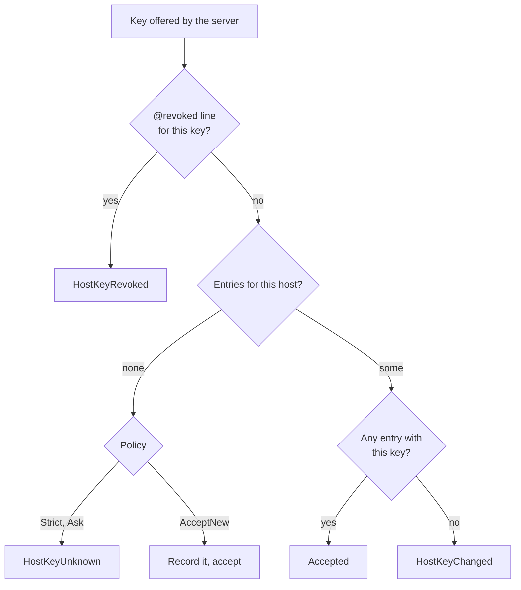
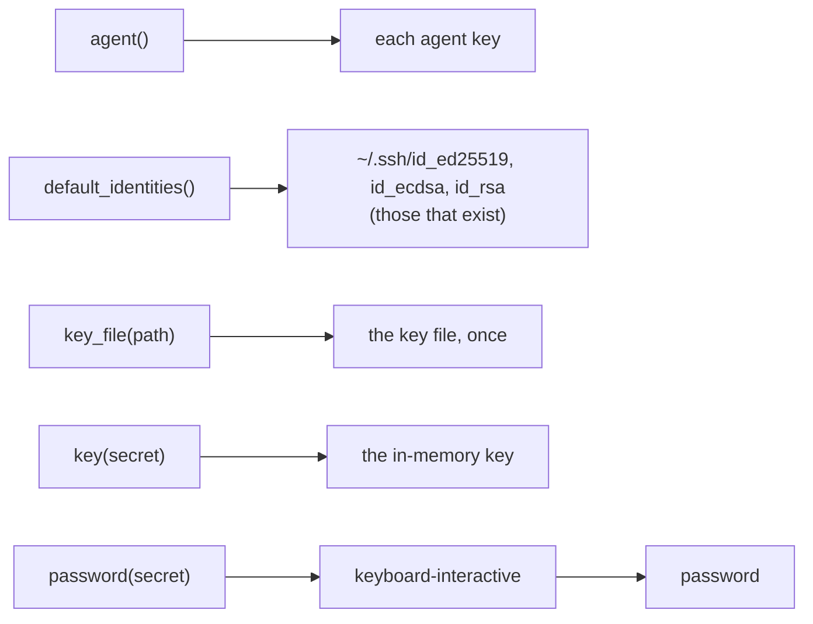
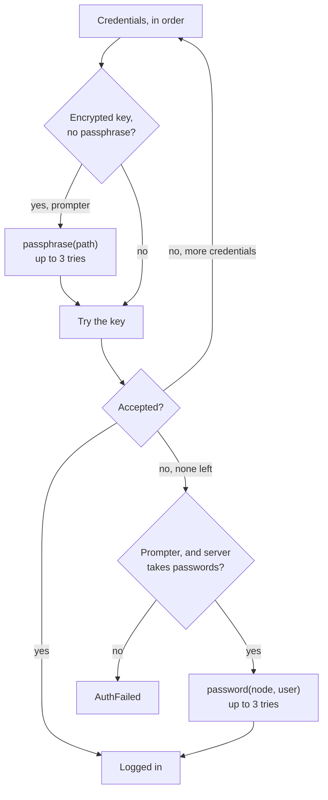
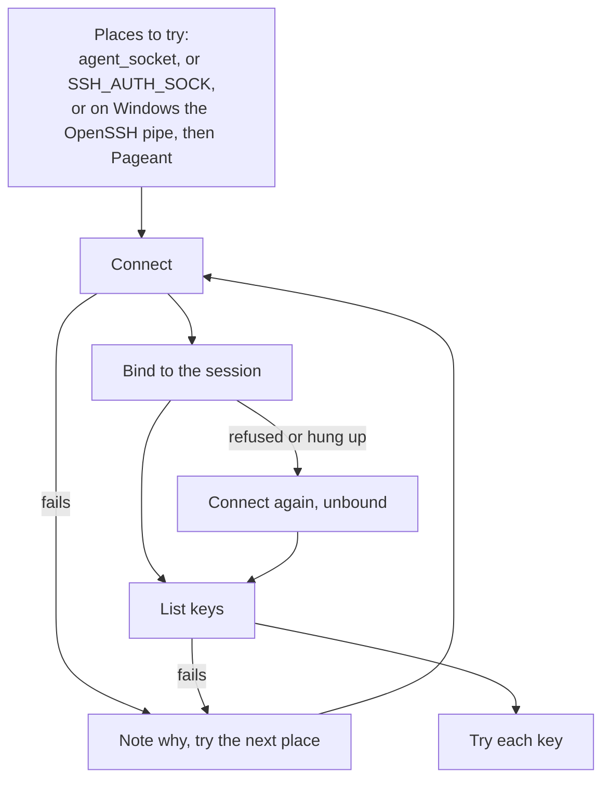

# Connecting

How `Session::connect` and `Session::connect_via` reach a server, check it is the right one,
and log in.

## Steps

For each hop, in order:

1. Reach the hop's `Node`: over TCP for the first hop, or through a `direct-tcpip` channel
   opened by the previous hop (see "Jump hosts"). Then the SSH handshake
   (`russh::client::connect_stream`).
2. During the handshake `russh` calls `Client::check_server_key`, which runs
   `host_key::check` with the hop's `HostKeyPolicy`. A refusal ends the connection with a
   `HostKey*` error. Host certificates are refused: `russh` does not ask for them unless
   told to, and Jato does not.
3. `auth::authenticate` tries the hop's credentials in order until one is accepted.

Steps 1 and 2 share `ConnectOptions::connect_timeout`; step 3 has
`ConnectOptions::auth_timeout`. Either one running out gives `Error::Timeout`.



## Probing

`Session::probe(hop, options)` runs steps 1 and 2 for a single hop, then disconnects
without step 3. It answers "is an SSH server there?" more strictly than a TCP connect: a
port that accepts connections but does not speak SSH, such as a device whose SSH server is
still starting or a port forward with nothing behind it, fails or times out. `russh`'s
`connect_stream` returns only once key exchange has finished, so a successful probe means
the server completed key exchange and passed the hop's host key check. The hop's credentials
are not used, so the server logs no login attempt. `connect_timeout` limits the whole probe,
and the hop's legacy setting applies.



`Session::host_key(hop, options)` is the same handshake, returning the host key that passed
the check in OpenSSH public key form, as `ssh-keyscan` prints it. The `russh` handler keeps
the key it checked in a `OnceLock` shared with `handshake`, which returns it with the
handle; a handshake that finished without checking a key fails as `Error::Protocol`. A
server has a key for each algorithm it supports but offers only one: the first in the
client's host key preference that the server has. Types already recorded for the server
move to the front of that preference ([Host keys](#host-keys)), so once the key is recorded
with `KnownHosts::record`, a strict connection is offered the same key again.

## Keepalives

`ConnectOptions::keepalive_interval` (30 seconds by default) sends a keepalive request when
the server has been quiet that long, and `keepalive_max` (3) is how many may go unanswered
before the connection is given up, as OpenSSH's `ServerAliveInterval` and
`ServerAliveCountMax` (which OpenSSH leaves off by default; Jato turns them on, so a dead
network path is noticed within about 90 seconds rather than at a long command's time limit).
They are set on each hop's `russh` connection.

When the connection goes while `Session::run` waits, the channel closes without an exit
status; `run` then sees the connection closed and returns `Error::ConnectionLost` rather than
output with an unknown exit. A test pauses the server's container (`docker pause`), which
looks like a dead path: the connection stays open but nothing answers. With keepalives every
second and two allowed to go unanswered, the loss is reported within seconds; without them
the same test runs into the command's time limit.

## Jump hosts

`Session::connect_via(jumps, target, options)` works like OpenSSH's `ProxyJump`. The first
jump host is reached over TCP. Each hop after it is reached through a `direct-tcpip` channel
opened by the hop before it, so its name is resolved by that jump host, not locally. The
channel reports `127.0.0.1` port 0 as the originator.

Every hop has its own `Auth`, `HostKeyPolicy` and legacy setting. The time limits apply to
each hop separately. Errors name the hop that failed; `Error::Tunnel` names both the jump
host and the hop it could not reach.

The `Session` keeps each jump host's connection open behind the target's. Dropping it
closes them all; `Session::close` disconnects the target first, then the jump hosts from
the nearest back. If a hop fails while connecting, the jump hosts already open are closed.

## Host keys

`host_key::verdict` reads the `known_hosts` text the way OpenSSH does:

- A server on port 22 is looked up as `host`, any other port as `[host]:port`, without case.
- Entries may list several patterns, with `*` and `?` wildcards and `!` negations; a matching
  negation rules the entry out. Hashed entries (`|1|salt|hash`, from `ssh-keygen -H`) are
  compared with HMAC-SHA1.
- `@revoked` refuses a key for every host. `@cert-authority` lines are ignored.
- Lines that cannot be parsed are skipped.
- The key is known if any entry for the server matches it. If entries exist but none
  match, the key has changed. A key of a different type counts as changed too, so a
  server offering a new key type cannot downgrade the check to "unknown".

Before the handshake, `host_key::preferred_algorithms` reads the same file and puts the
host key algorithms for the key types recorded for the server first, as OpenSSH does. A
server recorded only by its RSA key, which also has an ed25519 key, then presents its RSA
key and is known, rather than presenting ed25519 and looking changed. All RSA signature
hashes count as the RSA key type. `Insecure` keeps `russh`'s default order.

`AcceptNew` appends a plain `host key` line for an unknown server, creating the file and
directory if needed. `Strict` never writes.

`Ask` asks a person first, as OpenSSH's `StrictHostKeyChecking ask` does. In the handshake it
checks as `Strict` does and refuses an unknown server with `Error::HostKeyUnknown`, which
carries the fingerprint and the key. `open_hop` then asks the hop's `Prompter`
(`confirm_host_key(node, fingerprint)`, on a blocking thread). If it confirms, the key is
recorded with `KnownHosts::record`, the prompter is told (`host_key_recorded`), and the
handshake runs again, accepting exactly that key and no other. Only that hop is redone; jump
hosts already open stay open. Nothing is asked inside the handshake, so the connect time limit
does not cut the person off. Without a prompter, or if it declines, the refusal is returned,
so `Ask` with no prompter is `Strict`. A changed or revoked key is never asked about.

```text
handshake (checks as Strict)
  |
  +- ok ---------------------------------------------> log in
  +- HostKeyUnknown, policy Ask, hop has a prompter
  |    confirm_host_key(node, fingerprint)
  |      no  --> HostKeyUnknown
  |      yes --> KnownHosts::record, host_key_recorded
  |              handshake again (a different key now is HostKeyChanged)
  +- any other refusal or error ---------------------> error
```

A caller can also do this itself with `Strict`: show the fingerprint from
`Error::HostKeyUnknown`, `KnownHosts::record` the key, and connect again.

A policy checks a `KnownHosts` list of files, as OpenSSH checks `UserKnownHostsFile` and
`GlobalKnownHostsFile`: the key is known if any file records it, a revocation in any file
refuses it, otherwise a file recording other keys for the server makes it changed (the
error names that file and line), and `AcceptNew` records into the first file. Missing files
count as empty. `HostKeyPolicy::strict(file)`, `ask(file)` and `accept_new(file)` are the
one-file case.
The recorded key types offered first in the handshake are gathered from all the files.



`Insecure` skips all of this and accepts any key.

## Algorithms

`algorithms::preferred` picks what is offered in the handshake. By default these are
`russh`'s modern defaults, minus the `ssh-rsa` (SHA-1) host key algorithm, which `russh`
includes and OpenSSH dropped in 8.8.

`Hop::allow_legacy_algorithms` adds, after the modern algorithms, what older network devices
may need: SHA-1 key exchange (`diffie-hellman-group14-sha1`, `-group-exchange-sha1`,
`-group1-sha1`), the `ssh-rsa` host key, CBC ciphers (`aes128/192/256-cbc`) and SHA-1 MACs
(`hmac-sha1`, `hmac-sha1-etm`), plus SHA-1 RSA login signatures. Modern algorithms stay
first, so a server that supports them still negotiates them. The option is per hop, so a
jump host can stay strict while the old device behind it does not. `3des-cbc` needs the
`russh` `des` feature and is not offered.

OpenSSH 9.x lists `rsa-sha2-512` in `server-sig-algs` even when `PubkeyAcceptedAlgorithms`
allows only `ssh-rsa`, so the SHA-1 login path cannot be tested against it; it is covered
by unit tests.

## Authentication

`Auth::attempts` turns the credentials into attempts, in the order they were added:




- A password becomes keyboard-interactive, then password. Network devices often accept only
  keyboard-interactive. Hidden prompts are answered with the password; echoed prompts get
  an empty answer.
- The default identities become the key files `~/.ssh/id_ed25519`, `id_ecdsa` and `id_rsa`
  that exist, in that order.
- A key file is tried once, even if it is listed twice.

### Asking for secrets

An `Auth` (or a hop, or a whole `Route` with `Route::connect_with_prompter`) can carry a
`Prompter`, which a caller implements to ask a person, as `ssh` asks on its terminal. Without
one nothing is asked, which suits automation. With one:

- An encrypted key file given without a passphrase (`key_file(path, None)`, or a default
  identity) asks `Prompter::passphrase(path)`. A wrong passphrase is asked again, up to three
  times, as OpenSSH's `NumberOfPasswordPrompts`.
- When every credential has failed and the server still accepts keyboard-interactive or
  password login, `Prompter::password(node, username)` is asked, up to three times. Each
  answer is tried with keyboard-interactive if the server accepts it, else as a password.
- Returning `None` stops asking. The prompter is called on a blocking thread
  (`spawn_blocking`), so it may read a terminal.
- With `HostKeyPolicy::Ask`, an unknown host key asks `Prompter::confirm_host_key` (see Host
  keys). Its default refuses, so a prompter written only for secrets keeps unknown servers
  out.

`PromptCache` (`ssh/prompt_cache.rs`) wraps a prompter for programs that open many
connections, such as provisioning many hosts through one jump host. Each connection attempt
gets `cache.prompter(inner)`. A question's first asking in that connection is answered from
the cache if it holds an answer; otherwise, and when the same question comes again in the
same connection (the cached answer was wrong), it goes to `inner`, and the answer is kept.
Declined questions are not kept, and host key questions always go to `inner`.

`TerminalPrompter`, with the `terminal` feature, asks OpenSSH's questions on the terminal; see
[terminal.md](terminal.md).



After a refusal, the server lists the methods it still accepts, and later attempts using
other methods are skipped. A credential that cannot be used (a key file that is missing or
cannot be decrypted, no agent running) is skipped. Every attempt, and every skip with its
reason, is listed in `Error::AuthFailed`.

RSA keys sign with the strongest SHA-2 hash the server lists (`rsa-sha2-512`, then `-256`),
or SHA-256 if it lists none. SHA-1 (`ssh-rsa`) is used only on a hop that allows legacy
algorithms, when the server lists nothing better. Other key types skip that lookup, which
can wait up to a second.

The ssh-agent is found by `ssh::agent`. A socket given with `Auth::agent_socket` is used on
its own. Otherwise, on Unix, `SSH_AUTH_SOCK` names the socket. On Windows, `SSH_AUTH_SOCK`
names a pipe if it is set; otherwise the OpenSSH agent that ships with Windows
(`\\.\pipe\openssh-ssh-agent`) is tried, then Pageant. The first that lists its keys is
used, and if none does, the reason lists each place tried and what went wrong there. Listing
the keys, not only connecting, decides it: the Pageant client connects even when Pageant is
not running, and fails only when asked for keys. Which places to try is a pure function
(`agent_endpoints`) unit-tested for both platforms; only the connecting is per platform,
through `russh`'s Unix socket, named pipe and Pageant clients.

The agent is first asked to bind to the session (`session-bind@openssh.com`), so it can
refuse to sign for another one. The OpenSSH agent on Windows does not know this extension
and closes the connection when asked, so after a failed bind the agent is reached again and
used unbound. An integration test runs this against an agent that hangs up on extension
requests.



The OpenSSH agent on Windows keeps its keys encrypted for the user with DPAPI. In a session
without the user's password, such as an SSH login with a key, it refuses to add keys
(`agent refused operation`), as Windows has no key to decrypt with. A desktop session, or
an SSH login with a password, works. This has been run on Windows Server 2022: Jato found the
agent with no `SSH_AUTH_SOCK` set and logged in with a key held only by the agent.

## Secrets

Passwords and keys are passed to `russh` as plain strings for the protocol messages and key
parsing, and Jato cannot wipe those copies. Its own copies are held in `Secret` values.
