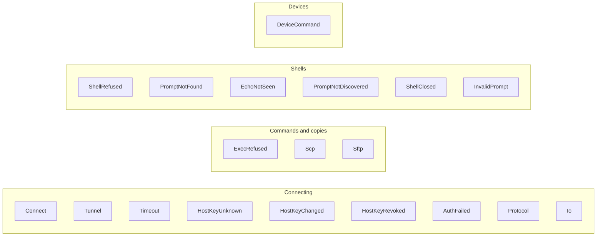

# Errors

Jato has one error type, `jato::Error` (`src/shared/error.rs`), a `thiserror` enum marked
`#[non_exhaustive]`: variants are added as the library grows, so callers match with a
wildcard arm. There is no `Result` alias.

## What an error carries

Every variant names the `Node` it concerns (except `Io` and `InvalidPrompt`, which may
happen before there is one) and what was being done, so an error read on its own says where
and what. The underlying cause, where there is one, is kept as the `source`.

An error never holds a secret. It does not hold:

- passwords, keys or passphrases, nor the attempts' credentials (`AuthFailed` lists the
  attempts by kind, such as `key file /path` or `password`);
- commands or configuration lines, which may hold a secret (`DeviceCommand` names the step,
  such as `config line 3`, never the line);
- command output, which may hold secrets (`PromptNotFound` and `ShellClosed` keep only the
  last line, usually the prompt that was not recognised).

It may hold what a device or server says about a failure, such as `% Invalid input` or the
remote `scp` program's message, and the last line of a failing shell command's output.

## Variants by layer

| Variant | Raised when |
| ------- | ----------- |
| `Connect` | The TCP connection to the first hop fails |
| `Tunnel` | A jump host cannot open a tunnel to the next hop (names both) |
| `Timeout` | An operation runs past its limit; `operation` says which (`connect`, `authentication`, `command`, `scp upload`, `scp download`, `sftp start`, `sftp request`) |
| `HostKeyUnknown`, `HostKeyChanged`, `HostKeyRevoked` | The host key check refuses the server; they give the key's fingerprint, the `known_hosts` file and, where there is one, the line |
| `AuthFailed` | No credential is accepted; lists each attempt and why credentials were skipped |
| `Protocol` | The SSH protocol fails, wrapping the `russh` error |
| `Io` | A local I/O operation fails, such as reading `known_hosts` |
| `ExecRefused` | The server will not run a command |
| `Scp` | A copy fails, with the remote program's message |
| `Sftp` | An SFTP operation fails, naming it and the path, with the server's status code and message |
| `ShellRefused` | The server will not give a PTY or a shell |
| `PromptNotFound` | The prompt does not appear in time; gives the last line |
| `EchoNotSeen` | The prompt came back without the command's echo |
| `PromptNotDiscovered` | No steady prompt appeared while discovering it |
| `ShellClosed` | The shell closed while Jato waited for a prompt |
| `InvalidPrompt` | A prompt pattern is invalid, or a device's prompt does not fit its profile |
| `DeviceCommand` | A device reports an error, a shell command exits non-zero, or a step (enable, configuration, commit) does not do what was asked |

## Inside the crate

`russh` errors are wrapped with `Error::protocol(node, source)` at the point they occur, so
the node is known. Internal helpers that cannot know the node return `russh::Error` and the
caller wraps it. The `russh` handler has its own error type, `connect::ClientError`, so a
host key refusal raised inside the handshake comes out of `russh` as Jato's own error, not as
a protocol error.
