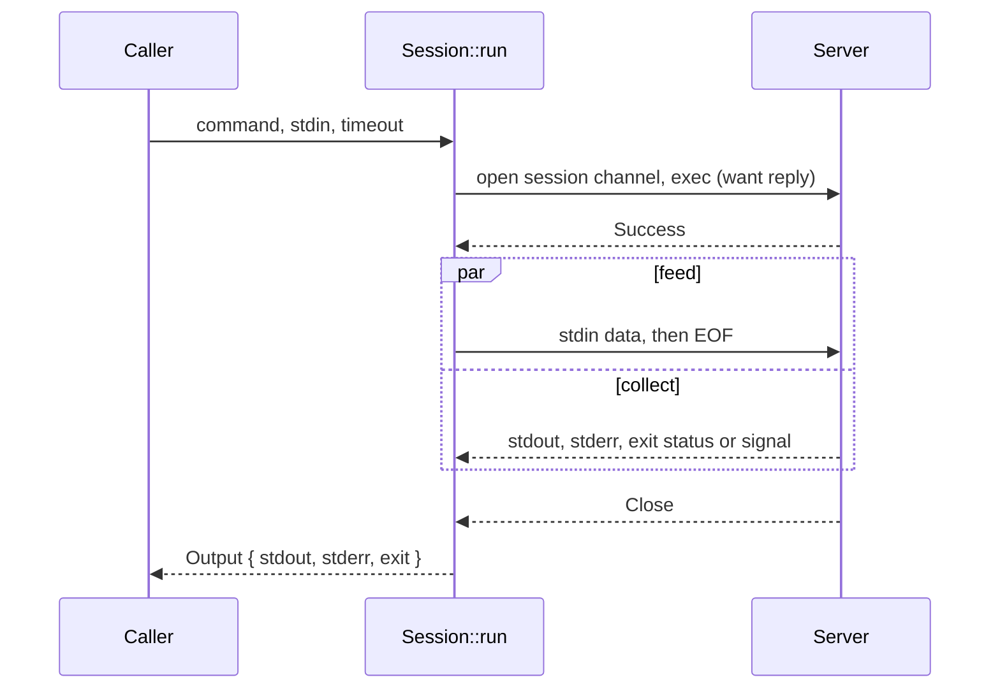

# Running commands

How `Session::exec` and `Session::run` run a command on the server.

## Exec channel

`Session::exec` opens a session channel and sends an `exec` request with `want_reply`, then
waits for the server's answer. `Failure`, or the channel closing first, is
`Error::ExecRefused`. Output that arrives before the answer is kept and returned first.
There is no terminal (no PTY), so stdout and stderr stay separate and nothing is echoed.

Channel messages map to events (`ssh::channel::step`, shared with shells):

| Message | Event |
| ------- | ----- |
| `Data` | `Event::Stdout` |
| `ExtendedData` type 1 | `Event::Stderr` |
| `ExitStatus` | `Event::Exit(Exit::Code)` |
| `ExitSignal` | `Event::Exit(Exit::Signal)`, the name without `SIG` |
| `Close` | end of events (`next_event` returns `None`) |

`Eof` and other messages produce no event. Output can follow the exit event until the
channel closes.

## run

`Session::run` starts the command, then writes stdin and collects output at the same time,
so a large stdin cannot stall against output filling the channel window. When the channel
closes the output is returned, even if stdin was not fully written: a command may exit
without reading it. If no exit status or signal was sent, `Output::exit` is
`Exit::Unknown`; some network devices never send one.

Every `run` takes a time limit for the whole command. When it runs out, the channel is
dropped, which closes it, and `Error::Timeout` names the `command` operation.

Collecting ends the call when the channel closes; feeding is dropped then if it has not
finished, which is how a command that ignores its stdin does not hold `run` up.

## Secrets

Commands are not logged or put in errors. They are still visible on the server (in process
lists and audit logs), so secrets belong on stdin.
