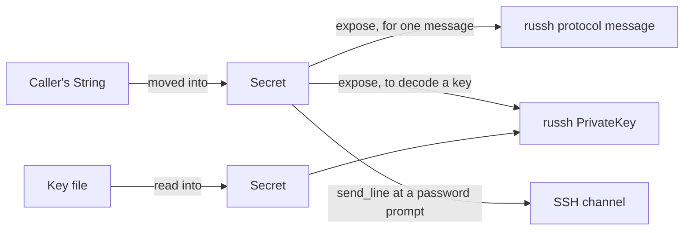

# Secrets

Passwords, private keys and passphrases are held in `jato::Secret` (`src/secret.rs`).

## Secret

- It owns a `String`. `Secret::new` and `From<String>` take ownership, so Jato makes no copy
  of its own.
- `expose()` is the only way to read it.
- `Debug` prints `Secret(<redacted>)`. There is no `Display`, `Clone`, `PartialEq` or
  serialization, so a secret cannot be printed, copied or compared by accident.
- On drop the string is overwritten with zeros (the `zeroize` crate), and the type implements
  `ZeroizeOnDrop`, which a unit test checks.

`Auth`, which holds credentials, derives `Debug` safely because every secret in it is a
`Secret`.

## Where copies go

Wiping covers only memory a `Secret` owns. Outside it:

- A caller's `String` that grew and was reallocated before it became a `Secret` may have
  left copies.
- `russh` takes passwords and keyboard-interactive answers as plain `String`s for its
  protocol messages, and decodes keys into its own types. Jato cannot wipe those.
- A password sent at a prompt (`enable`, `sudo`) goes through the channel as bytes.

## Never logged

Nothing that may hold a secret is logged or put in a span or an error: credentials,
passphrases, commands, configuration lines, what is sent to a shell, and output. Spans record
identifiers instead: the node, the username, sizes and counts. See [errors.md](errors.md) for
what errors may hold.
