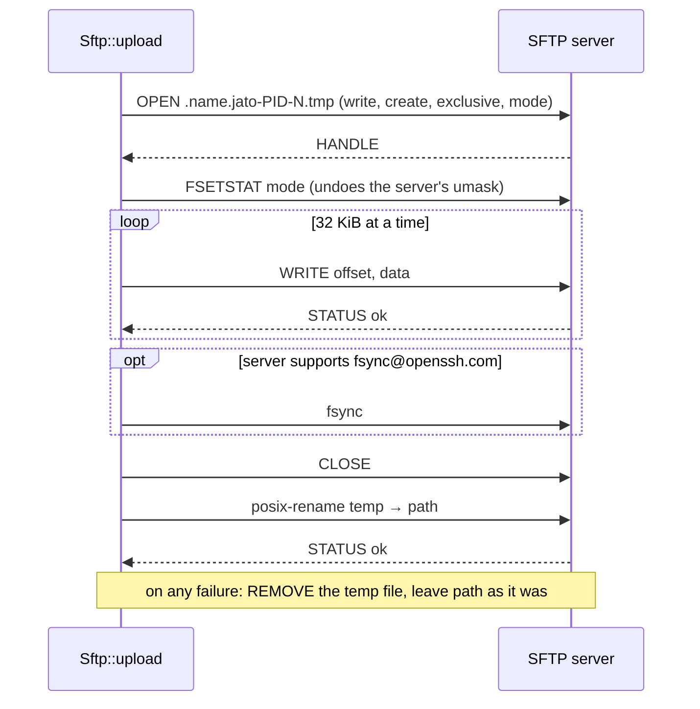

# SFTP

Jato has its own small SFTP client (`src/sftp/`), speaking SFTP version 3 over an `sftp`
subsystem channel. It does not use `russh-sftp`, which ships a server too and pulls in
`chrono`, `dashmap` and `serde`; packets are encoded with `ssh-encoding`, which `russh`
already re-exports.

## Modules

| File | Purpose |
| ---- | ------- |
| `packet.rs` | The messages Jato sends and receives, encoded and decoded by pure functions |
| `attrs.rs` | `Metadata`, a file's attributes, and their encoding |
| `client.rs` | `Sftp`: starting the subsystem, one request at a time, and the operations |

## Packets

Every packet is a 32-bit length, then a type byte, then (except `INIT` and `VERSION`) a
32-bit request id, then the fields. Strings are a 32-bit length and the bytes.

```text
 ┌──────────────┬──────┬──────────────┬──────────────────────────────┐
 │ length (u32) │ type │ request id   │ fields                       │
 │              │ (u8) │ (u32)        │ (strings, u32, u64, attrs)   │
 └──────────────┴──────┴──────────────┴──────────────────────────────┘
   counts everything after itself
```

| Sent | Received |
| ---- | -------- |
| `INIT`, `OPEN`, `CLOSE`, `READ`, `WRITE`, `STAT`, `SETSTAT`, `FSETSTAT`, `MKDIR`, `REMOVE`, `RENAME`, and the `EXTENDED` requests `posix-rename@openssh.com` and `fsync@openssh.com` | `VERSION`, `STATUS`, `HANDLE`, `DATA`, `ATTRS`, `EXTENDED_REPLY` |

Packets from the server are untrusted, so reading them is strict:

- A packet's length must be 1 to 256 KiB (OpenSSH's `sftp-server` limit) before anything is
  buffered for it.
- Every field length is checked against the bytes actually present (`ssh-encoding` refuses a
  string longer than what is left), so a lying length cannot cause a large allocation.
- Unknown packet types and bytes left over after the fields are refused.
- A reply must carry the id of the request it answers.
- A download reserves at most 1 MiB up front, whatever size the server reports.

Unit tests cover each request's encoding, each reply's decoding, and truncated, lying,
unknown and over-long packets.

## Starting

`Session::sftp(timeout)` opens a session channel, requests the `sftp` subsystem (a refusal is
`Error::Sftp` with operation `start`), sends `INIT` for version 3 and reads `VERSION`, keeping
the names of the extensions the server announces. The time limit applies to the start and
then to each request.

## Uploads



Why each step:

- **A new temporary file, created exclusively.** The file at `path` is never opened for
  writing, so its contents are never half-written, and an existing file with a looser mode is
  never written into: a secret is never readable by others, even briefly.
- **The mode at creation, then again with `FSETSTAT`.** The server applies its umask to the
  mode given at creation; a strict umask (`internal-sftp -u 077`) would turn `0644` into
  `0600`. Setting it again on the open file gives exactly the mode asked for. A test runs
  under umask `077` and fails without this step.
- **`fsync`, when offered,** so the data is on disk before the rename makes it visible.
- **`posix-rename`.** SFTP version 3's own `RENAME` fails if the target exists; OpenSSH's
  extension replaces it atomically. Servers without it get a plain rename after the target is
  removed, which is not atomic.
- **A taken temporary name** (status 4, which `sftp-server` gives for an existing file) is
  retried with the next number, up to three times. Any other error is returned as the server
  gave it.

Temporary names are `.name.jato-PID-N.tmp` beside the target, so the rename stays on one
file system.

## Other operations

- `download` opens the file, reads 32 KiB at a time until the server says end of file, and
  closes it.
- `metadata` (`STAT`, following links) returns `Metadata`: size, owner, group, mode bits and
  file type, and times. `exists` is `true` for any answer but "no such file".
- `create_dir_all` walks the path from the top, creating each missing directory with the mode
  and then setting it again; a part that exists but is not a directory is an error, and a
  directory created by someone else in the meantime is accepted.
- `rename` uses the same rename as uploads; `remove_file` removes one file.

## Errors

`Error::Sftp` names the operation (`upload`, `write`, `mkdir`, `rename` and so on) and the
path involved, with the server's status code and message: 2 is no such file, 3 permission
denied, 4 a general failure. A packet that cannot be read, or a reply to the wrong request,
is `Error::Protocol`; a request that takes too long is `Error::Timeout` with operation
`sftp request`.
