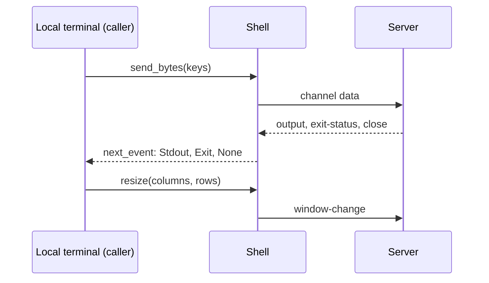
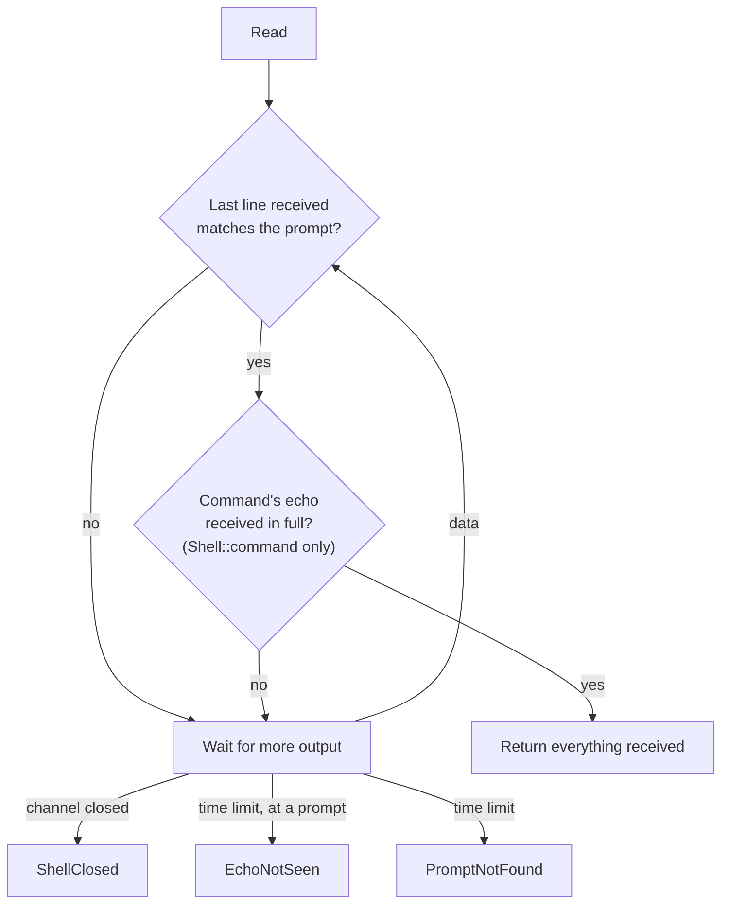

# Interactive shells

How `Session::shell` and `Shell` drive an interactive CLI.

## Opening

`Session::shell` opens a session channel and requests a PTY, then a shell, each with
`want_reply`; a refusal of either is `Error::ShellRefused`. The defaults are a `dumb` terminal,
511 columns and 24 rows: `dumb` stops device CLIs redrawing lines, and the width stops them
wrapping long ones. A PTY merges stderr into stdout, and the server echoes what is sent.

## Passing a shell through to a terminal

The same `Shell` can back a person's terminal instead of prompt matching, as an `ssh`
client does. The caller sets `ShellOptions` to the local terminal's `TERM`, columns and rows,
then:

- `Shell::send_bytes` sends key presses unchanged, control characters included;
- `Shell::resize` sends a `window-change` request when the local window changes size;
- `Shell::next_event` returns output as it arrives, then the shell's `Exit`, then `None`
  when the channel closes. Output that `read_until` had buffered and not returned comes first.

The local terminal (raw mode, reading keys, watching for resizes) is the caller's: Jato has no
terminal dependency.



## Prompts

A `Prompt` is a regular expression (the `regex` crate, which matches in linear time) anchored
to a whole line: `Prompt::new(r"\S+#")` matches `router1#` and not `x router1#`. The `regex`
type is not exposed, so the crate can be upgraded without changing Jato's API.
`Prompt::any_of` combines prompts, as a device does with its mode prompts.

`Shell::read_until` reads until the last line received matches the prompt, and returns
everything up to and including it. The last line is taken as a terminal shows it: ANSI
sequences are removed, and only the text after the last carriage return counts. Only that
line is decoded on each packet, so long outputs are not re-scanned.

A line of output (not the echo) that looks exactly like the prompt and arrives at the end of
a packet still ends the read early; this is inherent in prompt matching, and an exact,
discovered prompt makes it unlikely.

How a read ends:



## Discovering the prompt

When the prompt is not known, `Shell::read_until_quiet` reads until output arrives and then
pauses for a given idle time, and `Shell::discover_prompt` sends empty lines until two in a row
end on the same, non-empty line (at most five tries), which it returns. `Prompt::literal`
matches that text exactly. A device's banner should be read first, so its last line is not
taken for the prompt.

```text
 Jato                      Device
  │ ── "\n" ──────────────▶ │
  │ ◀── "...\r\nrouter1#" ─ │   last line "router1#"   (first)
  │ ── "\n" ──────────────▶ │
  │ ◀── "\r\nrouter1#" ──── │   last line "router1#"   same twice → the prompt
```

## Commands

`Shell::command` sends a line and reads until the prompt, but only once the line's echo has
arrived in full. Without that, an echo split across packets can end the read early: FreeBSD's
`sh` echoed `echo $0; id -un` as `echo $` and then the rest, and a loose `$` prompt matched the
first piece, leaving every later read one command behind. A prompt that comes back without
the echo is `Error::EchoNotSeen`. The output is then cleaned
(`shell::command_output`): ANSI sequences and `\r` removed, the prompt line dropped, the first
line dropped if it is the echoed command, and blank lines trimmed from both ends.

## Errors

`Error::PromptNotFound` and `Error::ShellClosed` report only the last line received, usually
the prompt that was not recognised. The rest of the output is not kept in errors, as it may
hold secrets (`show running-config`). Nothing sent is logged, so a password can be typed at a
password prompt.
