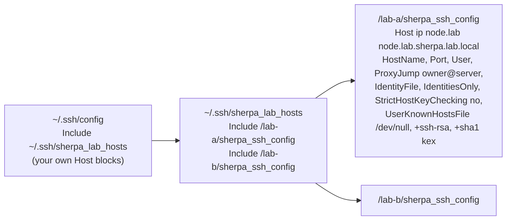
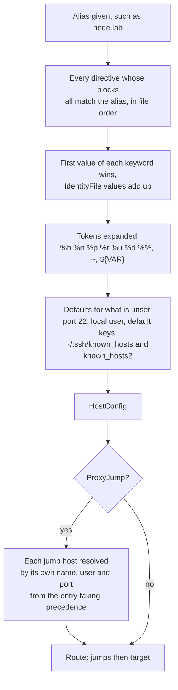

# OpenSSH client configuration

`SshConfig` (`src/ssh_config/`) reads OpenSSH's `ssh_config` files and works out a host's
settings as `ssh` would, then turns them into Jato's own: a `Hop` per host, and a `Route`
through any jump hosts. Settings in code stay the primary way to use Jato; this is an opt-in
helper that produces the same settings.

## Modules

| File | Purpose |
| ---- | ------- |
| `lexer.rs` | One line into a keyword and its values: `=` or whitespace, quotes, escapes, comments |
| `file.rs` | Files into a flat list of directives, each with the `Host` blocks it sits in; `Include` |
| `resolve.rs` | A host's settings (`HostConfig`) under OpenSSH's rules; `ProxyJump` routes |
| `hop.rs` | `HostConfig` into a `Node`, an `Auth`, a `HostKeyPolicy` and a `Hop` |
| `config.rs` | `SshConfig` (loading) and `Route` (connecting) |

## Loading

`SshConfig::load` reads `~/.ssh/config` and then `/etc/ssh/ssh_config`, each if it exists, as
`ssh` does. `SshConfig::load_file(path)` reads only that file, as `ssh -F path` does, which is
how Sherpa's provisioner runs `ssh` today.

Each file is read into directives in order. A `Host` line starts a block; a `Match` line
starts a block that never applies (Jato does not support `Match`, and logs a warning).
`Include` is expanded in place: `~` is expanded, relative paths are taken from `~/.ssh` (or
`/etc/ssh` in the system file), a wildcard in the last part matches files in sorted order, a
pattern that matches nothing is skipped (as in OpenSSH), and includes nest at most 16 deep.
An `Include` inside a `Host` block applies only within it: what it includes is tagged with
that block as well as its own. A line that cannot be parsed is an error naming the file and
line.

This is the layout Sherpa writes, which Jato reads as `ssh` does:



## Resolving a host



The rules, as in OpenSSH:

- A block applies if any of its patterns matches the alias as given (not its `HostName`)
  and none of its negated (`!`) patterns does; matching ignores case. Patterns use `*` and
  `?`, with the matcher `known_hosts` uses (`shared::glob`).
- The first value found for a keyword is used, across every matching block, so specific
  blocks go before `Host *`. `IdentityFile` is the exception: every value is collected.
- `HostName` takes `%h` (the alias) and `%%`. `IdentityFile` and `UserKnownHostsFile` take
  `%h` (the host name), `%n` (the alias), `%p`, `%r` (remote user), `%u` (local user), `%d`
  (home) and `%%`, a leading `~`, and `${VAR}`. An unknown token or unset variable is an error.
- `ProxyJump` is `none` or a comma-separated list of `[user@]host[:port]`, with IPv6
  addresses in brackets. Each jump host is resolved by its own name, so its `Host` block
  applies; a user or port in the entry overrides it. The first jump host's own `ProxyJump`
  is followed (as `ssh` reaches it with its own configuration); later jump hosts' are not,
  as in OpenSSH. A loop, or more than 16 jumps, is an error.

## From settings to a connection

| Setting | Jato |
| ------- | ---- |
| `HostName`, `Port` | `Node` |
| `User` | `Auth::new(user)` |
| `IdentitiesOnly no` (default) | the agent first, then the key files |
| `IdentityFile` | those key files; without any, the default identities |
| `IdentitiesOnly yes` | the key files only, no agent |
| `UserKnownHostsFile`, `GlobalKnownHostsFile` | `KnownHosts`: the user's files, then the global ones; `none` lists none |
| `StrictHostKeyChecking yes`, `ask` (default) | `HostKeyPolicy::Strict` with those files |
| `StrictHostKeyChecking accept-new` | `HostKeyPolicy::AcceptNew` with those files, recording in the first user file |
| `StrictHostKeyChecking no` / `off` | `HostKeyPolicy::Insecure` |
| An algorithm list that adds or lists a legacy algorithm (`+ssh-rsa`, `+diffie-hellman-group14-sha1` and the like) | `Hop::allow_legacy_algorithms` |
| `ConnectTimeout` | replaces `ConnectOptions::connect_timeout` (`HostConfig::connect_options`) |
| `ServerAliveInterval`, `ServerAliveCountMax` | replace `keepalive_interval` (0 turns keepalives off) and `keepalive_max` |

`Route::connect` connects through the jump hosts with `Session::connect_via`. Callers who
need more, such as a password, build hops themselves from `HostConfig::node`, `auth` and
`host_key_policy`.

## Differences from OpenSSH

- **Unsupported keywords** are listed in `HostConfig::unsupported` and logged: at debug level
  for those that do not change where or how securely Jato connects (`SendEnv`,
  `HashKnownHosts`, `Compression` and others common in system files), as a warning
  for the rest (`ProxyCommand`, `PreferredAuthentications`, `IdentityAgent` and others).
- **Algorithm lists** only switch legacy algorithms on. Removing algorithms (`-list`),
  reordering (`^list`) or a replacement list without legacy algorithms is unsupported, as
  Jato keeps its own lists.
- **`StrictHostKeyChecking no`** accepts any key, where OpenSSH still notices a changed one
  (and turns off password logins).
- **`IdentitiesOnly yes`** means the key files only, with no agent; OpenSSH may still use the
  agent to sign with those keys.
- **Default keys** are tried as `id_ed25519`, `id_ecdsa`, `id_rsa`; OpenSSH starts with
  `id_rsa`.
- **`HashKnownHosts`** is ignored: `AcceptNew` records hosts in plain form.

## A lab's own `known_hosts`

Because every listed file is checked and new keys go to the first, a set of hosts can keep
its own trust record apart from `~/.ssh/known_hosts`. This is how Sherpa labs can check node
keys instead of turning checking off: lab addresses are reused, so their keys in the user's
file would look changed in the next lab.

```text
Host node1.lab1
    StrictHostKeyChecking accept-new          # or yes, once the file holds the node keys
    UserKnownHostsFile /path/to/lab/known_hosts ~/.ssh/known_hosts
```

The first connection records the node in the lab's file; later ones are checked against it,
and a different machine answering at the same name is refused as changed. Deleting the lab
deletes its file. An integration test runs exactly this.

## Tests

Unit tests cover the lexer, reading files and includes, resolving (Sherpa's lab block by
each alias, first-value and accumulating rules, negation, tokens, defaults, algorithm lists,
unsupported keywords, bad values) and the mapping to hops. Integration tests compare every
resolved setting with OpenSSH's own `ssh -G -F` for the same file, including Sherpa's
include chain and lists of `known_hosts` files, and connect from configuration: Sherpa's
layout through a "server" container to a node, a jump chain defined by aliases, and a lab's
own `known_hosts` file recording, then checking, then refusing an impostor.
