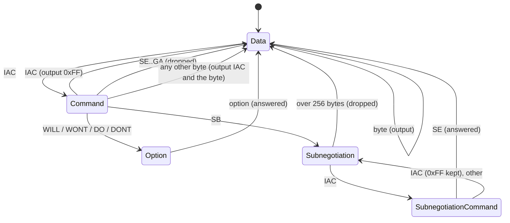
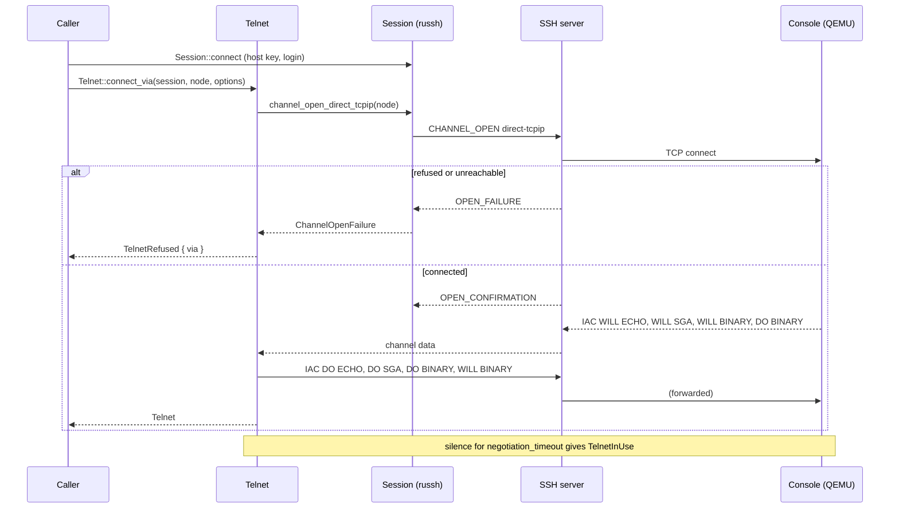

# Telnet

What the optional `telnet` feature adds: a telnet client for serial consoles, such as the
ones QEMU serves for virtual machines, over TCP or through an SSH server. The code is in
`src/telnet/`. The feature is off by default, so a cleartext protocol is an explicit choice,
and it adds no dependency: it uses the Tokio TCP and timers Jato already has.

| File | Holds |
| ---- | ----- |
| `protocol.rs` | `Protocol`: the decoder, the option policy and the encoder, with no I/O |
| `client.rs` | `Telnet`, `TelnetOptions`: `connect`, `connect_via`, sending, events, resize, break |
| `interactive.rs` | with `terminal`: `Telnet::interactive` and `TelnetEnd` |

## The API

| Item | Does |
| ---- | ---- |
| `TelnetOptions` | `connect_timeout` (10 s), `negotiation_timeout` (`Some(3 s)`), `term`, `columns`, `rows`; `#[non_exhaustive]` with `Default` |
| `Telnet::connect(node, options)` | TCP to `node` within `connect_timeout`, then waits for the server's first bytes |
| `Telnet::connect_via(session, node, options)` | the same over a `direct-tcpip` channel of an SSH `Session`; the SSH server dials `node` |
| `Telnet::send_bytes` | typed bytes, `0xFF` doubled, CR as CR NUL unless binary was agreed |
| `Telnet::next_event` | `Event::Stdout` with the protocol removed; `None` once the server closes. Cancel-safe |
| `Telnet::resize` | sends the window size only if the server asked for it (`DO NAWS`) |
| `Telnet::send_break` | `IAC BREAK` |
| `Telnet::interactive(options)` | with `terminal`: the console in the local terminal, returns `TelnetEnd { escaped }`; `InteractiveOptions::banner` turns the banner lines off |

Errors: `TelnetRefused` (refused or unreachable, directly or by the SSH server), `TelnetTimeout`
(no connection within `connect_timeout`), `TelnetInUse` (connected, then silence for
`negotiation_timeout`), `TelnetClosed` (closed before the first bytes, or broken while
reading or sending), and `Tunnel` if the SSH connection itself fails while opening the
channel. The decoder is tolerant, so there is no protocol error. See [errors.md](errors.md).

## What QEMU does

Captured on a Sherpa lab (`cisco_iosv`, `ubuntu_linux`, `alpine_linux`) with a raw TCP client,
against the QEMU chardev `socket,telnet=on,server=on` that serves each serial console:

| Probe | Result |
| ----- | ------ |
| On connect, every console | the same 12 bytes, from QEMU, not the guest: `IAC WILL ECHO`, `IAC WILL SGA`, `IAC WILL BINARY`, `IAC DO BINARY` (`FF FB 01 FF FB 03 FF FB 00 FF FD 00`) |
| The system `telnet`'s reply | `DO ECHO`, `DO SGA`, `DO BINARY`, `WILL BINARY`, nothing else |
| Client offers `WILL NAWS`, `WILL TTYPE` | QEMU answers nothing; it never negotiates further |
| Client sends `IAC IAC` | the guest reads one `0xFF` |
| Client sends `IAC SB NAWS 0 65 0 66 IAC SE x` | the guest reads `00 41 00 42` as typed input, and `IAC SE` swallows the `x`: QEMU treats every IAC sequence as three bytes |
| The guest prints `0xFF` | it arrives as a single `0xFF`: QEMU does not double it |
| A second client while one is connected | TCP connects (backlog 1), then silence: no negotiation, no data, no error |
| Cisco IOS's own vty telnet, for comparison | `WILL ECHO`, `WILL SGA`, `DO TTYPE`, `DO NAWS`; after `WILL TTYPE` it sends `SB TTYPE SEND` |

## The protocol

`Protocol` keeps its state across reads, so a sequence split between two TCP reads, or two
SSH channel messages, is decoded whole.

- **Tolerant of QEMU's output.** A guest's `0xFF` is not doubled, so `IAC` followed by a byte
  that is not a telnet command (below `SE`) is output: both bytes are kept. A guest `0xFF`
  followed by a command byte (`0xF0` to `0xFF`) cannot be told from a command and is read as
  one; that is the protocol's ambiguity, and QEMU's.
- **A subnegotiation over 256 bytes** is not one Jato answers. It is dropped and the decoder
  goes back to output, rather than wait for an `IAC SE` that may never come and eat the
  console's output meanwhile.
- **Commands with no option** (`NOP`, `GA`, `AYT` and the rest from `SE` to `GA`) are dropped.

### Negotiation

Jato never starts a negotiation. It answers what the server offers, and only when the
option's state changes (RFC 1143), so a server repeating itself gets no answer and nothing
can loop. Against QEMU this gives exactly the system `telnet`'s reply.

| Option | Server says `WILL` | Server says `DO` |
| ------ | ------------------ | ---------------- |
| BINARY (0) | `DO` | `WILL` |
| ECHO (1) | `DO` | `WONT` |
| SGA (3) | `DO` | `WILL` |
| TTYPE (24) | `DONT` | `WILL`; `SB TTYPE SEND` is answered with `IS` and `TelnetOptions::term` |
| NAWS (31) | `DONT` | `WILL`, then the window size, and again on each `resize` |
| LINEMODE (34) and others | `DONT` | `WONT` |

A `WONT` or `DONT` for an agreed option is acknowledged once and turns it off.

**No subnegotiation is sent unasked.** QEMU passes one through to the guest as typed bytes,
so the window size goes only after `DO NAWS`, and the terminal type only after `DO TTYPE`
and `SB TTYPE SEND`. `Telnet::resize` on a QEMU console records the size and sends nothing;
a serial port has no window size anyway.

### Sending

`Protocol::encode` doubles `0xFF`. Once the server has asked for binary input (`DO BINARY`,
which QEMU does), Enter goes as a bare CR. Without binary, a CR not followed by LF goes as
CR NUL, as RFC 854 asks; QEMU would pass that NUL to the guest, which is why binary matters.
`IAC BREAK` (`FF F3`) is sent as is: QEMU raises a break on the guest's serial line.

## Connecting

`Telnet::connect` dials the node with `TcpStream::connect` within `connect_timeout`, then
`start` reads once within `negotiation_timeout`:

- bytes arrive: they are decoded, output is kept for the first `next_event`, and the replies
  are sent before `connect` returns;
- nothing arrives: `TelnetInUse`. A QEMU console gives a second client silence, so silence
  means another session holds it;
- the server closes without a byte: `TelnetClosed`.

With `negotiation_timeout: None` the first read is skipped, for a server that waits for the
client to speak.

`Telnet::connect_via` opens a `direct-tcpip` channel on an existing `Session`, as a jump
host is used (see [connecting.md](connecting.md)), and runs the same `start` over the
channel's stream. The SSH server resolves and dials the node, so a console listening on the
SSH server's loopback, as Sherpa's consoles do, is reachable from anywhere the SSH server is.
The telnet bytes are cleartext only between the SSH server and the console.

The `Telnet` holds the channel stream, not the `Session`; the caller keeps the session open
while the console is used, and closing it closes the channel.

## Inside `Telnet`

The stream is a `Box<dyn Transport>`, a private trait for `AsyncRead + AsyncWrite + Unpin +
Send`, so a TCP connection and an SSH channel stream are one type. Two buffers make
`next_event` safe to cancel, which the interactive loop's `tokio::select!` does whenever a
key or a resize comes first:

- `pending`: output decoded and not yet returned. A read is decoded at once, with no await
  between the read and storing its result.
- `outgoing`: replies and typed bytes not yet written. Each write removes what it wrote, so a
  cancelled flush resumes where it stopped. `send_bytes` writes after it, so replies and
  keys keep their order.

Once the server has closed, `next_event` returns `None` and sending fails with
`TelnetClosed` without touching the stream.

## In the terminal

`Telnet::interactive` reports the local window size (sent only if the server asked), then
runs the same loop as `Session::interactive_shell`, `terminal::passthrough::run` (see
[terminal.md](terminal.md)), with `Ctrl+]` added to `~.` as an escape. Raw mode, resizes, the
Windows console modes and the banner lines are that loop's. The banner is on by default;
with `InteractiveOptions { banner: false }` the console prints no lines of its own, and
`TelnetEnd::escaped` tells the caller whether an escape (`Ctrl+]` or `~.`) or the console
ended the session, so it can print its own.

## Testing

- Unit tests in `protocol.rs`, built from the captures above: the QEMU greeting and its
  reply, split at every byte; `IAC IAC` both ways; a stray `0xFF`, also split from the next
  byte; options answered once, withdrawn and refused; CR with and without binary; no NAWS
  unasked, NAWS after `DO NAWS` with 255 doubled; the IOS vty greeting and `TTYPE SEND`; a
  subnegotiation split at every byte and one over the cap.
- Integration tests in `tests/integration/telnet.rs`, against servers built in each test on a
  local TCP listener that act as QEMU does. They need no Docker and are not ignored: connect
  and negotiate, resize sending nothing, `send_break`, refused, a connect timeout (a full
  accept queue, Linux only), in use, and closed both before and after connecting.
  `connect_via_reaches_the_console_through_an_ssh_server` (ignored, needs the test image)
  runs the console on this host's Docker gateway address and reaches it through the test SSH
  server, and checks a refusal names the SSH server.
- `examples/console.rs` (`cargo run --example console --features terminal,telnet -- <host>
  <port> [--via <ssh host>] [--no-banner]`) runs a console in the terminal; it was used
  against a Sherpa lab's Alpine console, directly and through an SSH server, with both
  escapes. With `--no-banner` it prints its own closing line from `TelnetEnd::escaped`.
