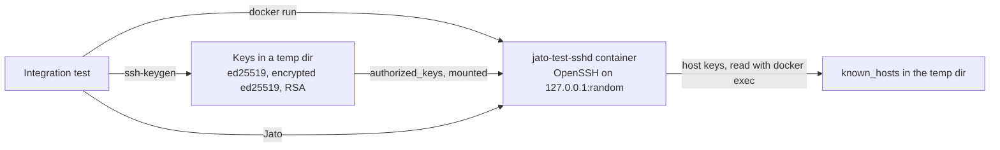
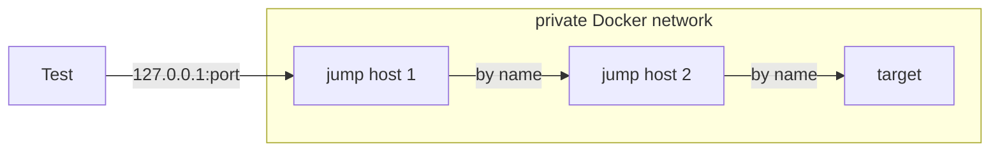

# Testing

Three kinds of tests, all run with `cargo test`:

| Kind | Where | Needs | Run with |
| ---- | ----- | ----- | -------- |
| Unit | `#[cfg(test)]` modules at the end of each source file | nothing | `cargo test` |
| Container | `tests/integration/` | Docker, `ssh-keygen`, `ssh-agent`, the `jato-test-sshd` image | `cargo test -- --ignored` |
| Real devices and hosts | `tests/integration/devices.rs`, `hosts.rs` | targets in the environment | `cargo test -- --ignored` |

Integration tests are marked `#[ignore]`, so plain `cargo test` runs only unit tests. They
are one test binary, `tests/integration/main.rs`, with a module per area, so the shared
helpers in `support/` are compiled once.

## Unit tests

Pure logic is kept in functions that do no I/O, so it can be tested directly:
`known_hosts` matching (`host_key::verdict`), the order of authentication attempts
(`Auth::attempts`), algorithm lists, SCP headers and quoting, channel messages to events
(`exec::step`), ANSI stripping and output cleaning, prompt matching, echo checks, and turning
a discovered prompt into mode prompts (`ModePrompts::from_prompt`).

## The test container

`tests/sshd/` builds a Debian image with OpenSSH, `sudo` and a user `jato`
(`docker build -t jato-test-sshd tests/sshd`). Password and keyboard-interactive logins are on,
and the user may `sudo` with its password. `support::sshd::Sshd` starts one container per test
on a random local port, makes keys for it, waits for its SSH banner, and removes the
container and its files on drop. Tests can pass extra `sshd -o` options, for example to allow
only legacy algorithms or turn off keyboard-interactive.

Jump host tests put containers on a private Docker network (`support::sshd::Network`). Only
the first is reached on its published port; the others are reached by container name, which
resolves only inside that network, so a login proves the connection went through the jump
hosts.

## Real devices and hosts

Device and host tests need targets, given by environment variables with a prefix per kind
(`support::target::Target`): `JATO_<KIND>_HOST`, `_USER` and `_KEY` (a private key file), and
for shells optionally `_ENABLE` (`sudo -s` if not set). The kinds are `IOS`, `NXOS`, `EOS`,
`JUNOS`, `UBUNTU`, `ALPINE`, `FREEBSD` and `OPENBSD`. A kind that is not set makes its tests
return early, which shows as passed, as Rust's test runner has no "skipped" result; run with
`--nocapture` to see `testing <KIND> at <host>` for each target used.

The targets so far have been Sherpa lab nodes, reached directly from the Sherpa server, with
host keys unchecked (`Insecure`) and legacy algorithms allowed, as for lab nodes. The device
tests change each device's configuration and undo it, and one IOS test creates a user and an
enable secret and removes them.

Notes from running against real devices:

- A freshly booted NX-OS can refuse configuration ("Configuration locked. Upgrade in
  progress") for a few minutes after it answers SSH.
- vJunos can take a minute after the lab is ready before its SSH answers.
- Tests that set the same device-wide setting, such as the IOS enable secret, must not run at
  the same time; they are combined into one test.
